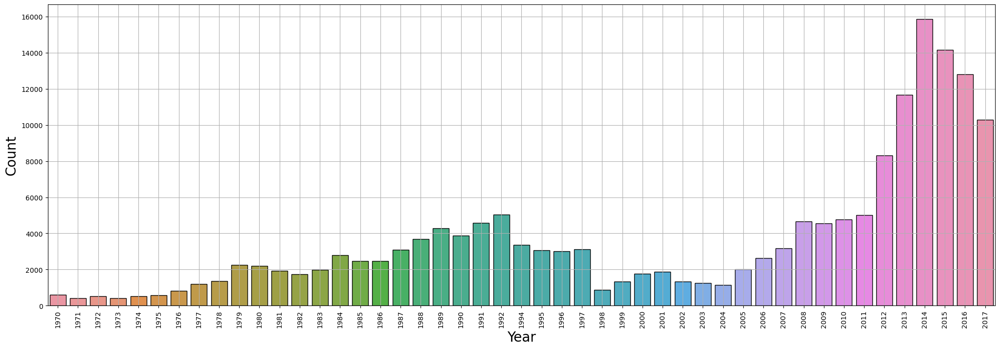
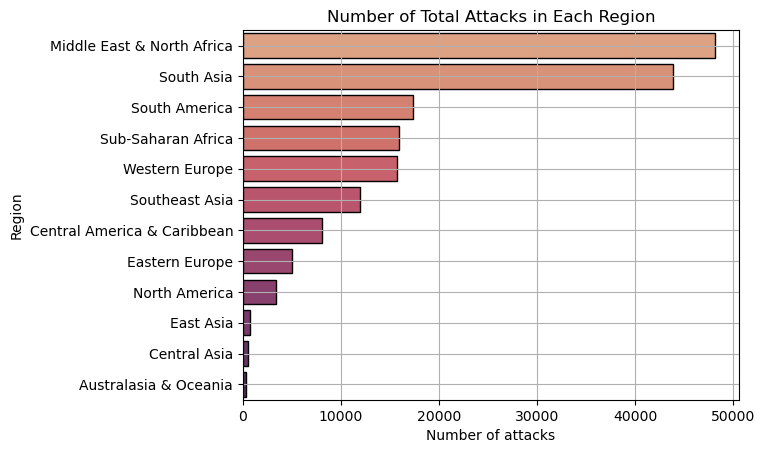

> How have recorded incidents changed over time and across regions? A data study of more than 170,000 records.

**Training project · Data Science & Business Analytics track**  
**Tools:** Python, pandas, NumPy, Matplotlib, Seaborn

## The challenge

Large public safety databases are hard to read directly. This study cleans one and turns it into clear trends by year and region.

## The data

The Global Terrorism Database to 2017: 181,691 records and 135 fields, reduced to 8 fields and 170,943 complete records.

## How it works

1. Reduced 135 columns to the 8 needed, and cleaned the records, leaving 170,943.
2. Tracked incidents and casualties per year.
3. Compared regions, countries, and types of targets.

## A closer look

- **Cleaning:** kept the fields needed, and removed incomplete records.
- **Trends:** incidents and casualties per year, and by region.
- **Comparison:** countries, cities, and types of targets.

## Key decisions

- Reducing 135 fields to 8 keeps the study focused and easier to check.

## Results

| Measure | Result |
|---|---|
| Records after cleaning | **170,943** |
| Year with the most recorded deaths | **2014 (15,881)** |
| Regions with most incidents | **Middle East & North Africa, South Asia** |

## Visual results

*Recorded incidents per year*

*Recorded incidents by region*

## Programming skills

- Python programming
- Working with a large dataset in pandas
- Selecting fields and cleaning records
- Aggregating data over time and by region
- Data visualization

## Good to know

- The figures describe what the database recorded, and reporting differs between countries and periods.
- This is a descriptive study of a sensitive topic. It does not explain causes.

## What I would do next

- Compare with other sources, to account for differences in reporting.

<strong>بالعربي: تحليل بيانات الأمن العالمي</strong>

دراسة وصفية لأكثر من 170 ألف سجل، تبين الاتجاهات حسب السنة والمنطقة. أعلى عدد وفيات مسجل كان في 2014.

**ملاحظة:** الأرقام تصف ما سجلته القاعدة ولا تفسر الأسباب، والموضوع حساس.

**المهارات البرمجية:** Python programming، Working with a large dataset in pandas، Selecting fields and cleaning records، Aggregating data over time and by region، Data visualization.

الكود خاص، وهذه الصفحة تعرض فكرة المشروع وطريقة عمله ونتائجه.

---

**About the source code:** the code for this project is private. This page presents what it does, how it works, and its results. To talk about the work, contact me through my [GitHub profile](https://github.com/SamerAlTaki97).
